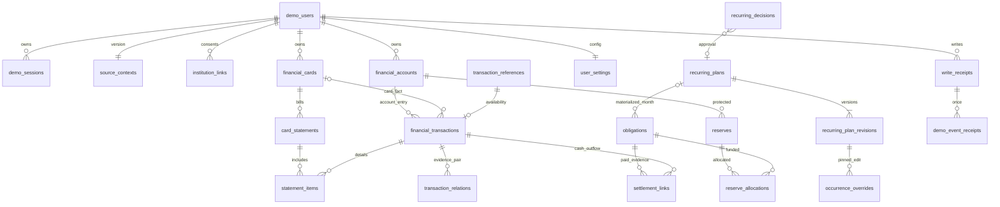

# PAYSE v1.0 DB 설계

2026-10-19 · #19 준비 산출물 · 기존 공통 MD를 변경하지 않는 구현 제안. 기준 커밋 `a008df66b0a7399bbc7b369ff89368a42f4d4986`.

## 목적·적용 범위

[데이터 명세](data-model-draft.md), [공통 DB 기초](../../../docs/database-schema.md), [계산 규칙](../../../docs/calculation-rules.md)에 있는 의미를 PostgreSQL 물리 구조로 구체화한다. SQL은 빈 개발 DB용이며 운영 DB 마이그레이션이 아니다. 서버/API/인증/Flutter 구현 완료를 뜻하지 않는다.

원천 계좌·카드·거래·청구와 확정 설정을 같은 DB에서 참조 검증한다. 원천 JSON은 재현 가능한 시드로 보존한다. `sourceVersion` 갱신 시 원천 행만 명시적으로 갱신하고 included/nickname/PAYSE 분류·계획·정산은 덮지 않는다. 이번 exporter는 최초 INSERT만 제공하며 원천 갱신 API는 구현하지 않았다.

**금액 계산·연간 소비·반복 미래 회차 생성·시뮬레이션은 Flutter다.** SQL의 정산/배정 합계 검사는 저장 한도를 지키기 위한 검사다. U·소비 결과·가상 구매·시뮬레이션 결과 테이블은 없다.

## 기존 초안과 달라진 물리 배치

총 **23개 테이블·182개 컬럼**이다. 이 숫자를 서비스의 이론적 최솟값으로 확정하지 않는다. 기존 14개 후보에 아래 9개 저장 단위를 추가한 이유는 각각 다르다.

| 새 저장 단위             | 필요한 이유                                                    |
| ------------------------ | -------------------------------------------------------------- |
| institutions             | 5은행·4카드 내부 코드의 FK 기준. 공급자 공식 코드와 분리       |
| source_contexts          | 동일 사용자 현재 원천 버전·asOf·coverage·명시 급여 근거의 기준 |
| transaction_references   | 실제 거래 행이 없는 기간 밖 원거래 ID도 지우지 않고 참조 유지  |
| statement_items          | 청구-거래-카드의 소유권을 복합 FK로 검증                       |
| transaction_relations    | 확인된 내부 이체/체크카드 쌍을 중복 기록 없이 보존             |
| recurring_plans          | 변경 이력과 무관한 안정된 월간 계획 ID                         |
| recurring_plan_revisions | 선택한 미래 월부터 변경하되 기존 회차가 참조한 버전 보존       |
| occurrence_overrides     | DB 의무로 만들지 않은 회차의 확정 개별 편집을 재접속 후 유지   |
| demo_event_receipts      | 같은 경제적 사건을 다른 요청 키로도 두 번 적용하지 않게 제한   |

- `recurring_decisions.obligation_id` 후보는 최신 월간 승인 결정에 따라 `plan_id`로 구체화했다.
- `user_settings.salary_evidence` 후보는 원천 사실이므로 `source_contexts.salary_evidence`에 저장하고 응답에서 salary.receiptEvidence로 조립한다.
- `balanceReflected`는 reflection_reason에서 파생한다. 둘을 독립 저장하여 상충시키지 않는다.
- recurrenceKey는 plan ID + `:` + 명목 YYYY-MM이다. DB는 plan_id/occurrence_month를 분리한다. 날짜 보정이 키를 바꾸지 않는다.
- 이미 저장된 회차는 obligations, 아직 의무로 저장하지 않은 확정 편집은 occurrence_overrides다. 같은 회차가 양쪽에 있으면 거절한다. 승격 시 같은 트랜잭션에서 override를 제거하고 의무를 만든다.
- 극한 조건 보완: 초안의 ‘같은 계획·시작 월에 버전 최대 1개’는 **현재 권위 버전(is_current=true) 최대 1개**로 구체화한다. 같은 미래 시작 월을 다시 수정하면 기존 버전을 false로 전환하고 새 버전을 추가한다. 기존 회차/개별 편집은 이전 revisionId를 유지한다. 참조된 버전의 내용 덮어쓰기는 DB에서 거절한다.
- 이 보완을 전달하기 위해 RecurringPlanRevision에 `isCurrent: boolean`을 추가했다. 새 미래 회차는 isCurrent=true인 버전 중 회차월 이하의 가장 늦은 effectiveFromMonth를 선택하고, 이미 저장된 회차는 자기 planRevisionId를 사용한다. 기존 MD는 수정하지 않았다. 이 필드와 해석은 Flutter 담당자와 API 고정 전에 확인할 연동 변경사항이다. 이전 필드만 소비하면 같은 시작 월의 구·신 버전이 모호해진다.

## 관계

ERD는 앱 상태상 필요한 관계도다. demo_users 생성과 user_settings/source_contexts 초기 행의 생성은 시드/서비스 트랜잭션 책임이며 DB FK만으로 자식 1개 존재를 강제하지 않는다. 카드 원천 출금 계좌는 null일 수 있다. 청구 대표 의무는 계좌/일정이 확인된 경우만 생성한다.

## 실행할 SQL과 검증 경계

1. [001_initial.sql](../database/001_initial.sql): 도메인·23테이블·FK·행 CHECK·인덱스·RLS. 이미 payse 스키마가 있으면 실패하고 덮지 않는다.
2. [002_storage_guards.sql](../database/002_storage_guards.sql): 사용자 행 잠금, 지연 저장 제약, 원거래 순환·정산 초과·보호 해제 중복·회차 이중 저장·주요 JSON 참조 검증.
3. `fixtures/export_sql.py`로 생성하는 시드: 트랜잭션 안의 INSERT만. 기존 행 수정·삭제·upsert 없음. 기본 복원은 연결0/선택0, `--ready`는 명시한 통합 검증 상태.
4. [test_constraints.sql](../database/test_constraints.sql), [test_extremes.sql](../database/test_extremes.sql): `payse_fixture_`로 시작하는 폐기 가능한 검증 DB에서 실행. 검사 행·역할·GRANT는 ROLLBACK.
5. [test_native_concurrency.py](../database/test_native_concurrency.py): 실제 PostgreSQL의 서로 다른 연결로 활성 세션·dataVersion·작업 키·eventId 경합 4개를 검사하는 후속 실행 도구. PGlite 결과와 구분한다.

RLS는 금융 행의 소유자를 검사하는 보조 방어다. 서버가 검증된 세션으로 트랜잭션마다 `SET LOCAL payse.user_id`를 설정해야 한다. 클라이언트가 보낸 userId를 신뢰해서 설정하지 않는다. 실사용 연결은 superuser/BYPASSRLS가 아니어야 하며 DB 접근 자격을 앱에 배포하지 않는다. 인증 조회용 최소 권한과 금융 조회/설정 쓰기 권한 분리는 #21/#20에서 구현한다. 이 SQL은 실행 역할·GRANT를 배포하지 않는다.

일반 앱 역할에는 원천 테이블 전체 UPDATE를 주지 않는다. 별칭/선택·분류처럼 허용된 컬럼 또는 전용 저장 경로만 부여한다. 데모 사건 원천 갱신은 별도 신뢰된 경로다. 현재 시드는 `code_verifier=DISABLED:auth-design-pending`이며 로그인 가능한 계정/세션은 발급하지 않는다.

## 쓰기 순서·동시성·삭제

- 한 사용자 확정 쓰기: 트랜잭션 시작 → 세션/소유자 검증 → demo_users 행 잠금 → 같은 멱등 키 조회(본문 digest 다르면 거절) → expectedDataVersion 비교 → 허용 설정/관계 변경 → write_receipts+dataVersion+필요 event 영수증 → COMMIT → 새 스냅샷 조회. 재시도 응답·digest 생성·오류 코드는 #20 구현 대상이다.
- 주요 저장 테이블의 BEFORE 트리거도 같은 사용자 행을 잠근다. 지연 트리거는 트랜잭션 최종 상태에서 검증한다. 한 작업에서 여러 사용자 행을 수정하지 않는다. 다중 사용자 운영 배치는 별도 잠금 순서/재시도 설계가 필요하다.
- 모든 FK 삭제는 RESTRICT다. 로그아웃은 세션 종료이며 금융 설정 삭제가 아니다. 기관 연결 해제도 원천/계획 CASCADE 삭제가 아니다. 데모 기록은 명시된 운영 초기화 전까지 보존하며 실서비스 보존기간을 임의로 확정하지 않는다.
- 기존 회차와 부분 정산 회차는 이후 계획 버전 변경으로 다시 쓰지 않는다. 실제 계획 변경 API는 ‘선택한 미래 월’ 조건을 검사해야 한다. 과거 시드 적재까지 금지하는 현재 날짜 CHECK는 만들지 않았다.
- 신규 보호액/증액의 계좌별·전체 선택 잔액 한도, 정정으로 과거 보호액을 복원하는 예외, 사용자 별칭 grapheme 규칙은 작업 종류/이전값이 필요한 #20 서비스 검증이다. 기존 R이 잔액 하락으로 커져 보이는 상태는 DB에서 허용하며 자동 감액하지 않는다.
- 거래 금액·날짜 입력의 완전한 외부 JSON 검증, 페이지/기관 권한에 따른 응답 조립, 공급자 별칭 매핑, 이벤트 원자 갱신 구현은 후속이다. 금융 수치가 BIGINT라는 이유만으로 JSON 소수를 허용하지 않는다. fixture 검증기는 소수와 bool을 거절한다.

## 인덱스·제약 이유

- 내부 UUID와 `(user_id,id)` 복합 유일키는 안정된 참조와 소유권 FK를 동시에 제공한다.
- 활성 세션/기관 연결, 활성 청구 의무, 유효 정산 쌍은 부분 UNIQUE다. 취소/정정 기록은 남길 수 있다.
- 거래 계좌/카드+날짜 인덱스는 1년 조회, 의무 예정일은 미지급 목록, 지급/배정 인덱스는 검증과 정정 조회를 위한 것이다. 성능 목표를 달성했다고 주장하지 않는다.
- 날짜·시각은 유한값, 금액은 9조원 범위, 문자열은 공백만인 값 금지. NULL 가능성은 아래 표에 별도 표시한다. 전체 JSON 구조 검증을 JSONB 타입 검사 하나로 대체하지 않는다.
- SQL 단일 행 CHECK와 다중 행 잠금·지연 검증을 구분했다. PostgreSQL은 다른 행에 의존하는 일반 CHECK의 일관성을 보장하지 않는다. [공식 제약 문서](https://www.postgresql.org/docs/17/ddl-constraints.html)
- RLS의 소유자/특권 역할 예외와 명시 행 잠금의 범위는 공식 문서를 기준으로 한다. [행 보안](https://www.postgresql.org/docs/17/ddl-rowsecurity.html), [행 잠금](https://www.postgresql.org/docs/17/explicit-locking.html)

## 컬럼 사전

ID/소유키는 기존 명세의 UUID다. `payse.money`는 음수 허용, `nonnegative_money`는 0 이상, `positive_money`는 1 이상인 원화 BIGINT이며 모두 9조원 상한이다. 생성 시각이 없는 원천에 현재 시각을 붙이지 않는다. ‘필수’는 NOT NULL이다.

### demo_users

사전 합성 사용자·낙관적 쓰기 버전.

| 컬럼            | 타입        | 필수 | 설정 근거                                               |
| --------------- | ----------- | ---- | ------------------------------------------------------- |
| id              | uuid        | 예   | 안정된 내부 식별자; 원천 버전·날짜 변경에도 유지        |
| synthetic_name  | text        | 예   | 합성 조회 이름; 제출 원문 저장소가 아님                 |
| synthetic_phone | text        | 예   | 합성 조회 전화번호; 단독 인증 불가                      |
| display_name    | text        | 예   | 허용 화면 표시명                                        |
| code_verifier   | text        | 예   | 서버 전용 코드 검증값; 이번 시드는 DISABLED로 인증 불가 |
| data_version    | bigint      | 예   | 원천/확정 설정 변경마다 한 트랜잭션에서 증가            |
| created_at      | timestamptz | 예   | 사전 사용자 생성 시각                                   |

### demo_sessions

기존 로그인 유지·신규 로그인 거절을 위한 최소 상태.

| 컬럼            | 타입        | 필수   | 설정 근거                                        |
| --------------- | ----------- | ------ | ------------------------------------------------ |
| id              | uuid        | 예     | 안정된 내부 식별자; 원천 버전·날짜 변경에도 유지 |
| user_id         | uuid        | 예     | 인증 세션에서 정한 소유자; 다른 사용자 참조 차단 |
| token_digest    | text        | 예     | 무작위 세션 토큰 검증값; 원문/PIN 저장 금지      |
| installation_id | uuid        | 예     | 설치 식별값; 이것만으로 인증하지 않음            |
| issued_at       | timestamptz | 예     | 실제 발급 시각                                   |
| ended_at        | timestamptz | 아니오 | 명시 종료 시각; null은 활성                      |

### institutions

5개 은행·4개 카드사 내부 코드 목록.

| 컬럼 | 타입 | 필수 | 설정 근거                              |
| ---- | ---- | ---- | -------------------------------------- |
| code | text | 예   | PAYSE 내부 코드; 공급자 공식 코드 아님 |
| kind | text | 예   | bank/card 구분                         |
| name | text | 예   | 표시명                                 |

### source_contexts

현재 공개 원천 묶음의 버전·기준시각·확보범위.

| 컬럼             | 타입        | 필수 | 설정 근거                                               |
| ---------------- | ----------- | ---- | ------------------------------------------------------- |
| user_id          | uuid        | 예   | 인증 세션에서 정한 소유자; 다른 사용자 참조 차단        |
| source_version   | text        | 예   | 사용자별 현재 원천 묶음 버전                            |
| schema_version   | text        | 예   | 전달 필드의 형식 버전                                   |
| rule_version     | text        | 예   | Flutter 계산 규칙 버전; 서버 계산을 의미하지 않음       |
| as_of            | timestamptz | 예   | 잔액·자료의 업무 기준시각                               |
| coverage         | jsonb       | 예   | 계좌/카드별 요청/확보/누락 구간; 참조는 loader/API 검증 |
| salary_evidence  | jsonb       | 예   | 명시 거래 ID와 partial/confirmed; 원천 근거             |
| occurrence_links | jsonb       | 예   | 확인된 구매/청구/회차 연결; 참조·중복은 loader/API 검증 |

### institution_links

원천 보유와 분리한 연결 동의 범위.

| 컬럼             | 타입        | 필수   | 설정 근거                                        |
| ---------------- | ----------- | ------ | ------------------------------------------------ |
| id               | uuid        | 예     | 안정된 내부 식별자; 원천 버전·날짜 변경에도 유지 |
| user_id          | uuid        | 예     | 인증 세션에서 정한 소유자; 다른 사용자 참조 차단 |
| institution_code | text        | 예     | 대상 기관                                        |
| consented_at     | timestamptz | 예     | 확정 연결 시각                                   |
| disconnected_at  | timestamptz | 아니오 | 해제 시각; null은 현재 연결                      |

### financial_accounts

계좌 원천과 구분된 선택/별칭 설정.

| 컬럼             | 타입        | 필수   | 설정 근거                                        |
| ---------------- | ----------- | ------ | ------------------------------------------------ |
| id               | uuid        | 예     | 안정된 내부 식별자; 원천 버전·날짜 변경에도 유지 |
| user_id          | uuid        | 예     | 인증 세션에서 정한 소유자; 다른 사용자 참조 차단 |
| institution_code | text        | 예     | 은행 내부 코드                                   |
| source_ref       | text        | 예     | 객체별 이름 공간을 가진 합성 원천 키             |
| source_version   | text        | 예     | 같은 사용자 현재 원천 묶음에 속함                |
| product_type     | text        | 예     | demand/savings/time_deposit/other                |
| product_name     | text        | 예     | 원천 상품 표시명                                 |
| masked_number    | text        | 예     | 가린 번호; 전체 번호 없음                        |
| balance_krw      | payse.money | 예     | 원천 잔액; 음수 허용                             |
| as_of            | timestamptz | 예     | 잔액 기준시각                                    |
| included         | boolean     | 예     | 사용자 홈 선택; 복원 초기값 false                |
| nickname         | text        | 아니오 | 사용자 별칭; null은 해제                         |

### financial_cards

카드 원천·확인된 출금 계좌와 일정.

| 컬럼                  | 타입  | 필수   | 설정 근거                                        |
| --------------------- | ----- | ------ | ------------------------------------------------ |
| id                    | uuid  | 예     | 안정된 내부 식별자; 원천 버전·날짜 변경에도 유지 |
| user_id               | uuid  | 예     | 인증 세션에서 정한 소유자; 다른 사용자 참조 차단 |
| institution_code      | text  | 예     | 카드사 내부 코드                                 |
| source_ref            | text  | 예     | 객체별 이름 공간을 가진 합성 원천 키             |
| source_version        | text  | 예     | 같은 사용자 현재 원천 묶음에 속함                |
| product_name          | text  | 아니오 | 확보된 원천 표시명                               |
| masked_number         | text  | 아니오 | 가린 카드 번호                                   |
| card_type             | text  | 예     | credit/debit/unknown; 미상을 신용으로 변환 금지  |
| withdrawal_account_id | uuid  | 아니오 | 실제 출금 계좌; 미상이면 null                    |
| schedule_evidence     | jsonb | 예     | 확인된 기간/결제일/근거; 빈 배열은 일정 미확보   |

### transaction_references

기간 밖·미확보 원거래 ID를 보존하는 참조 목록.

| 컬럼           | 타입 | 필수   | 설정 근거                                        |
| -------------- | ---- | ------ | ------------------------------------------------ |
| user_id        | uuid | 예     | 인증 세션에서 정한 소유자; 다른 사용자 참조 차단 |
| transaction_id | uuid | 예     | 자료가 없어도 보존할 안정된 원천 거래 참조       |
| resolution     | text | 예     | resolved/unavailable                             |
| reason         | text | 아니오 | 미확보 이유; resolved는 null                     |

### financial_transactions

기장/구매/환불/취소 사실과 별도 PAYSE 분류.

| 컬럼                    | 타입                    | 필수   | 설정 근거                                                               |
| ----------------------- | ----------------------- | ------ | ----------------------------------------------------------------------- |
| id                      | uuid                    | 예     | 안정된 내부 식별자; 원천 버전·날짜 변경에도 유지                        |
| user_id                 | uuid                    | 예     | 인증 세션에서 정한 소유자; 다른 사용자 참조 차단                        |
| source_ref              | text                    | 예     | 객체별 이름 공간을 가진 합성 원천 키                                    |
| source_version          | text                    | 예     | 같은 사용자 현재 원천 묶음에 속함                                       |
| account_id              | uuid                    | 아니오 | 기장 계좌; 카드 전용 기록은 null                                        |
| card_id                 | uuid                    | 아니오 | 관련 카드; 계좌 전용 기록은 null                                        |
| record_kind             | text                    | 예     | 원천 사건 종류                                                          |
| amount_krw              | payse.nonnegative_money | 예     | 거래 크기; 방향과 분리                                                  |
| direction               | text                    | 예     | in/out; 카드 out이 현금 출금이라는 뜻 아님                              |
| status                  | text                    | 예     | approved/posted/cancelled/unknown                                       |
| merchant_name           | text                    | 아니오 | 원천 거래처                                                             |
| description             | text                    | 아니오 | 원천 설명                                                               |
| purchase_date           | date                    | 아니오 | 확인된 이용일                                                           |
| withdrawal_date         | date                    | 아니오 | 확인된 계좌 출금일; 입금일 전용 금지                                    |
| refund_date             | date                    | 아니오 | 확인된 환불 반영일                                                      |
| booking_date            | date                    | 아니오 | 입금도 포함한 계좌 기장일                                               |
| occurred_at             | timestamptz             | 아니오 | 확인된 실제 시각만; 날짜만 있으면 null                                  |
| occurred_at_basis       | text                    | 아니오 | 어느 사실의 시각인지; 시각 없으면 null                                  |
| reflection_reason       | text                    | 예     | reflected/not_reflected/not_applicable/unknown; boolean은 응답에서 파생 |
| original_transaction_id | uuid                    | 아니오 | 확인된 원거래; 참조 목록으로 미확보도 보존                              |
| payse_transaction_type  | text                    | 아니오 | 사용자 정정 분류; 원천 재적재 시 보존                                   |
| installment_current     | integer                 | 아니오 | 확인된 할부 현재 회차                                                   |
| installment_total       | integer                 | 아니오 | 확인된 할부 총회차                                                      |

### card_statements

청구 총액과 실제 구매를 분리.

| 컬럼                | 타입                    | 필수   | 설정 근거                                        |
| ------------------- | ----------------------- | ------ | ------------------------------------------------ |
| id                  | uuid                    | 예     | 안정된 내부 식별자; 원천 버전·날짜 변경에도 유지 |
| user_id             | uuid                    | 예     | 인증 세션에서 정한 소유자; 다른 사용자 참조 차단 |
| source_ref          | text                    | 예     | 객체별 이름 공간을 가진 합성 원천 키             |
| source_version      | text                    | 예     | 같은 사용자 현재 원천 묶음에 속함                |
| card_id             | uuid                    | 예     | 해당 카드                                        |
| amount_krw          | payse.nonnegative_money | 예     | 확인된 청구 총액                                 |
| due_date            | date                    | 아니오 | 확인된 결제 예정일                               |
| period_start        | date                    | 아니오 | 확인된 이용기간 시작                             |
| period_end          | date                    | 아니오 | 확인된 이용기간 끝; 양 끝 포함                   |
| detail_completeness | text                    | 예     | complete/partial/unavailable                     |

### statement_items

청구에 포함된 거래의 동일 카드·사용자 관계.

| 컬럼           | 타입 | 필수 | 설정 근거                                        |
| -------------- | ---- | ---- | ------------------------------------------------ |
| user_id        | uuid | 예   | 인증 세션에서 정한 소유자; 다른 사용자 참조 차단 |
| statement_id   | uuid | 예   | 청구 참조                                        |
| card_id        | uuid | 예   | 교차 카드 참조를 복합 FK로 차단                  |
| transaction_id | uuid | 예   | 확보된 포함 구매/환불 참조                       |

### transaction_relations

확인된 이체 쌍/카드·계좌 동일 사건 연결.

| 컬럼         | 타입 | 필수 | 설정 근거                                        |
| ------------ | ---- | ---- | ------------------------------------------------ |
| user_id      | uuid | 예   | 인증 세션에서 정한 소유자; 다른 사용자 참조 차단 |
| kind         | text | 예   | card_account_pair/internal_transfer              |
| from_id      | uuid | 예   | 근거 있는 첫 거래                                |
| to_id        | uuid | 예   | 근거 있는 둘째 거래                              |
| evidence_ref | text | 예   | 자동 병합을 허용하는 명시 근거                   |

### user_settings

사용자 확정 급여·카드 계획 설정.

| 컬럼                | 타입                    | 필수   | 설정 근거                                        |
| ------------------- | ----------------------- | ------ | ------------------------------------------------ |
| user_id             | uuid                    | 예     | 인증 세션에서 정한 소유자; 다른 사용자 참조 차단 |
| salary_day          | smallint                | 아니오 | 1~31 또는 미입력 null                            |
| salary_amount_krw   | payse.nonnegative_money | 아니오 | 확정 예상 급여; 미입력을 0으로 대체 금지         |
| salary_account_id   | uuid                    | 아니오 | 급여 수령 계좌; 미입력 null                      |
| card_plan_overrides | jsonb                   | 예     | cardId/사용자 계획 결제일; 원천 일정과 분리      |

### recurring_plans

월간 반복 계획의 안정된 식별자.

| 컬럼                   | 타입 | 필수 | 설정 근거                                        |
| ---------------------- | ---- | ---- | ------------------------------------------------ |
| id                     | uuid | 예   | 안정된 내부 식별자; 원천 버전·날짜 변경에도 유지 |
| user_id                | uuid | 예   | 인증 세션에서 정한 소유자; 다른 사용자 참조 차단 |
| first_occurrence_month | date | 예   | 최초 명목 월의 1일; 과거 전체 소급 생성 금지     |

### recurring_plan_revisions

선택 미래 월부터 적용할 계획 이력.

| 컬럼                  | 타입                    | 필수   | 설정 근거                                                                 |
| --------------------- | ----------------------- | ------ | ------------------------------------------------------------------------- |
| id                    | uuid                    | 예     | 안정된 내부 식별자; 원천 버전·날짜 변경에도 유지                          |
| user_id               | uuid                    | 예     | 인증 세션에서 정한 소유자; 다른 사용자 참조 차단                          |
| plan_id               | uuid                    | 예     | 불변 계획 ID                                                              |
| effective_from_month  | date                    | 예     | 적용 시작 명목 월의 1일                                                   |
| label                 | text                    | 예     | 사용자 확인 명칭                                                          |
| amount_krw            | payse.nonnegative_money | 예     | 사용자 확인 금액                                                          |
| monthly_day           | smallint                | 예     | 원래 1~31일; 말일 보정으로 덮어쓰지 않음                                  |
| payment_timing        | text                    | 예     | immediate/card_bill                                                       |
| schedule_basis        | text                    | 예     | withdrawal/purchase                                                       |
| withdrawal_account_id | uuid                    | 예     | 확정 출금 계좌                                                            |
| card_id               | uuid                    | 아니오 | card_bill이면 필수                                                        |
| status                | text                    | 예     | active/cancelled                                                          |
| schedule_overrides    | jsonb                   | 예     | 확인된 개별 일정; 명목 월별 최대 1개                                      |
| is_current            | boolean DEFAULT true    | 예     | 같은 적용 시작 월의 현재 권위 버전; 이전 버전은 기존 회차 참조용으로 유지 |

### obligations

확정된 미지급 의무·필요한 반복 회차; 지급 완료 열 없음.

| 컬럼                  | 타입                    | 필수   | 설정 근거                                        |
| --------------------- | ----------------------- | ------ | ------------------------------------------------ |
| id                    | uuid                    | 예     | 안정된 내부 식별자; 원천 버전·날짜 변경에도 유지 |
| user_id               | uuid                    | 예     | 인증 세션에서 정한 소유자; 다른 사용자 참조 차단 |
| label                 | text                    | 예     | 사용자 확인 예정 지출명                          |
| withdrawal_account_id | uuid                    | 예     | 확정 출금 계좌                                   |
| amount_krw            | payse.nonnegative_money | 예     | 의무 전체 금액; 잔여액은 정산에서 로컬 산출      |
| due_date              | date                    | 예     | 확정 예정일                                      |
| status                | text                    | 예     | active/cancelled                                 |
| statement_id          | uuid                    | 아니오 | 청구 대표 의무이면 해당 청구                     |
| plan_id               | uuid                    | 아니오 | 직접 현금 반복 회차의 계획                       |
| plan_revision_id      | uuid                    | 아니오 | 해당 회차 생성 근거 버전; 이후 변경에 고정       |
| occurrence_month      | date                    | 아니오 | 명목 회차월 1일; 날짜 이동에도 키 불변           |

### occurrence_overrides

미저장 미래 회차의 사용자 개별 수정; 가상 구매 저장소 아님.

| 컬럼                  | 타입                    | 필수 | 설정 근거                                        |
| --------------------- | ----------------------- | ---- | ------------------------------------------------ |
| user_id               | uuid                    | 예   | 인증 세션에서 정한 소유자; 다른 사용자 참조 차단 |
| plan_id               | uuid                    | 예   | 반복 계획                                        |
| occurrence_month      | date                    | 예   | 명목 회차월 1일                                  |
| plan_revision_id      | uuid                    | 예   | 수정 당시 회차 근거 버전                         |
| amount_krw            | payse.nonnegative_money | 예   | 사용자가 확정한 해당 회차 금액                   |
| due_date              | date                    | 예   | 확정 출금 예정일                                 |
| withdrawal_account_id | uuid                    | 예   | 확정 출금 계좌                                   |
| status                | text                    | 예   | active/cancelled                                 |

### recurring_decisions

동일 후보 승인/제외의 중복 방지.

| 컬럼            | 타입  | 필수   | 설정 근거                                                                     |
| --------------- | ----- | ------ | ----------------------------------------------------------------------------- |
| id              | uuid  | 예     | 안정된 내부 식별자; 원천 버전·날짜 변경에도 유지                              |
| user_id         | uuid  | 예     | 인증 세션에서 정한 소유자; 다른 사용자 참조 차단                              |
| candidate_key   | text  | 예     | 같은 근거 집합+규칙의 후보 키                                                 |
| rule_version    | text  | 예     | 후보 계산 규칙                                                                |
| source_version  | text  | 예     | 승인 당시 원천 버전; 갱신 후에도 이력 유지                                    |
| evidence_refs   | jsonb | 예     | 근거 거래 ID 배열; 존재·소유권은 002 저장 제약, 후보 판단의 적합성은 API 검증 |
| normalized_name | text  | 예     | 확인한 이름                                                                   |
| decision        | text  | 예     | approved/excluded                                                             |
| plan_id         | uuid  | 아니오 | approved는 계획 필수, excluded는 null                                         |

### settlement_links

실제 출금과 의무 사이 부분 정산·정정 근거.

| 컬럼           | 타입                 | 필수   | 설정 근거                                        |
| -------------- | -------------------- | ------ | ------------------------------------------------ |
| id             | uuid                 | 예     | 안정된 내부 식별자; 원천 버전·날짜 변경에도 유지 |
| user_id        | uuid                 | 예     | 인증 세션에서 정한 소유자; 다른 사용자 참조 차단 |
| obligation_id  | uuid                 | 예     | 정산 대상 의무                                   |
| transaction_id | uuid                 | 예     | 실제 출금 근거                                   |
| allocated_krw  | payse.positive_money | 예     | 이 연결에 배정된 지급액                          |
| method         | text                 | 예     | automatic/manual                                 |
| evidence       | jsonb                | 예     | 명시 매핑 또는 사용자 확정 근거                  |
| invalidated_at | timestamptz          | 아니오 | 정정으로 무효화한 시각                           |

### reserves

현재 보호 설정; 매월 적립 약정 아님.

| 컬럼         | 타입                    | 필수   | 설정 근거                                               |
| ------------ | ----------------------- | ------ | ------------------------------------------------------- |
| id           | uuid                    | 예     | 안정된 내부 식별자; 원천 버전·날짜 변경에도 유지        |
| user_id      | uuid                    | 예     | 인증 세션에서 정한 소유자; 다른 사용자 참조 차단        |
| account_id   | uuid                    | 예     | 보호 금액이 속한 계좌                                   |
| label        | text                    | 예     | 사용자 명칭                                             |
| amount_krw   | payse.nonnegative_money | 예     | 해제를 반영한 현재 R; 원천 잔액 하락으로 자동 축소 금지 |
| cancelled_at | timestamptz             | 아니오 | 명시 취소 시각                                          |

### reserve_allocations

보호 설정과 의무의 명시 겹침 O 근거.

| 컬럼             | 타입                    | 필수 | 설정 근거                                                                          |
| ---------------- | ----------------------- | ---- | ---------------------------------------------------------------------------------- |
| id               | uuid                    | 예   | 안정된 내부 식별자; 원천 버전·날짜 변경에도 유지                                   |
| user_id          | uuid                    | 예   | 인증 세션에서 정한 소유자; 다른 사용자 참조 차단                                   |
| reserve_id       | uuid                    | 예   | 보호 설정                                                                          |
| obligation_id    | uuid                    | 예   | 충당할 의무                                                                        |
| amount_krw       | payse.positive_money    | 예   | 원래 배정액                                                                        |
| released_krw     | payse.nonnegative_money | 예   | 근거가 있는 해제 누계                                                              |
| release_evidence | jsonb                   | 예   | 정산 링크/해제액/정정 영수증; 참조·합계는 002 저장 제약, 작업 전후 상태는 API 검증 |

### write_receipts

멱등 결과와 정정에 필요한 최소 이력.

| 컬럼           | 타입        | 필수 | 설정 근거                                           |
| -------------- | ----------- | ---- | --------------------------------------------------- |
| id             | uuid        | 예   | 안정된 내부 식별자; 원천 버전·날짜 변경에도 유지    |
| user_id        | uuid        | 예   | 인증 세션에서 정한 소유자; 다른 사용자 참조 차단    |
| operation_key  | text        | 예   | 사용자별 재시도 키                                  |
| request_digest | text        | 예   | 허용된 설정 요청의 canonical digest; 인증 원문 제외 |
| action         | text        | 예   | 확정 쓰기 작업명                                    |
| changed_refs   | jsonb       | 예   | 변경된 설정/관계 참조                               |
| before_after   | jsonb       | 예   | 정정에 필요한 변경 필드만; 가상 시뮬레이션 제외     |
| result_version | bigint      | 예   | 커밋 결과 dataVersion                               |
| created_at     | timestamptz | 예   | 커밋 기록 시각                                      |

### demo_event_receipts

준비된 경제적 사건의 사용자별 1회 적용.

| 컬럼                  | 타입 | 필수 | 설정 근거                                            |
| --------------------- | ---- | ---- | ---------------------------------------------------- |
| user_id               | uuid | 예   | 인증 세션에서 정한 소유자; 다른 사용자 참조 차단     |
| event_id              | text | 예   | 버전 있는 fixture 사건 ID; 새 요청키로도 재적용 불가 |
| source_version_before | text | 예   | 적용 전 원천 버전                                    |
| source_version_after  | text | 예   | 적용 후 원천 버전                                    |
| receipt_id            | uuid | 예   | 같은 트랜잭션의 확정 쓰기 영수증                     |
