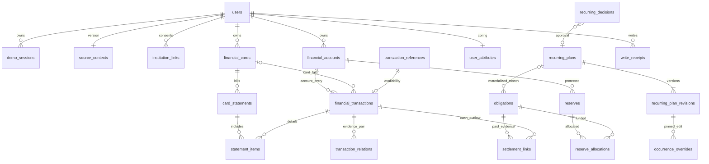

# PAYSE PostgreSQL 저장 구조와 컬럼 사전

물리 DB 구조의 단일 기준이다. 초기 DDL, 별도로 실행하는 기존 DB 이름 전환 도구, 인증 후속 DDL을 구분한다.

## 목적·적용 범위

[데이터 모델](data-model.md)의 논리 필드와 [공통 API 계약](api-contract.md)의 명령을 PostgreSQL 물리 구조로 구체화한다. 계산 정책의 단일 기준은 [계산 규칙](calculation-rules.md)이다. SQL은 빈 개발 DB용이며 운영 DB 마이그레이션이 아니다. 서버/API/인증/Flutter 구현 완료를 뜻하지 않는다.

원천 계좌·카드·거래·청구와 확정 설정을 같은 DB에서 참조 검증한다. 원천 JSON은 재현 가능한 시드로 보존한다. `sourceVersion` 갱신 시 원천 행만 명시적으로 갱신하고 included/nickname/PAYSE 분류·계획·정산은 덮지 않는다. exporter는 신규 DB의 초기 INSERT만 제공하며 원천 갱신 API는 구현하지 않았다.

**금액 계산·연간 소비·반복 미래 회차 생성·시뮬레이션은 Flutter다.** SQL의 정산/배정 합계 검사는 저장 한도를 지키기 위한 검사다. U·소비 결과·가상 구매·시뮬레이션 결과 테이블은 없다.

## 저장 단위와 물리 배치

현재 초기 SQL은 **22개 테이블·175개 컬럼**이다. users는 단일 name을 저장한다. 이 정의가 이미 존재하는 DB에 자동 적용되는 것은 아니다. 이 숫자를 서비스의 이론적 최솟값으로 확정하지 않는다. 아래는 관계를 분리한 추가 저장 단위의 이유이며 전체 22개 테이블은 컬럼 사전에 정의한다.

| 저장 단위                | 필요한 이유                                                       |
| ------------------------ | ----------------------------------------------------------------- |
| institutions             | 은행 기준정보·카드사 내부 코드의 FK 기준. 공급자 공식 코드와 분리 |
| source_contexts          | 동일 사용자 현재 원천 버전·asOf·coverage·명시 급여 근거의 기준    |
| transaction_references   | 실제 거래 행이 없는 기간 밖 원거래 ID도 지우지 않고 참조 유지     |
| statement_items          | 청구-거래-카드의 소유권을 복합 FK로 검증                          |
| transaction_relations    | 확인된 내부 이체/체크카드 쌍을 중복 기록 없이 보존                |
| recurring_plans          | 변경 이력과 무관한 안정된 월간 계획 ID                            |
| recurring_plan_revisions | 선택한 미래 월부터 변경하되 기존 회차가 참조한 버전 보존          |
| occurrence_overrides     | DB 의무로 만들지 않은 회차의 확정 개별 편집을 재접속 후 유지      |

- `recurring_decisions.plan_id`는 월간 승인으로 등록된 계획을 참조한다.
- 급여 입금 근거는 원천 사실이므로 `source_contexts.salary_evidence`에 저장하고 응답에서 salary.receiptEvidence로 조립한다.
- `balanceReflected`는 reflection_reason에서 파생한다. 둘을 독립 저장하여 상충시키지 않는다.
- recurrenceKey는 plan ID + `:` + 명목 YYYY-MM이다. DB는 plan_id/occurrence_month를 분리한다. 날짜 보정이 키를 바꾸지 않는다.
- 이미 저장된 회차는 obligations, 아직 의무로 저장하지 않은 확정 편집은 occurrence_overrides다. 같은 회차가 양쪽에 있으면 거절한다. 승격 시 같은 트랜잭션에서 override를 제거하고 의무를 만든다.
- 같은 계획·시작 월의 **현재 권위 버전(is_current=true)은 최대 1개**다. 같은 미래 시작 월을 다시 수정하면 기존 버전을 false로 전환하고 새 버전을 추가한다. 기존 회차/개별 편집은 이전 revisionId를 유지한다. 참조된 버전의 내용 덮어쓰기는 DB에서 거절한다.
- RecurringPlanRevision의 `isCurrent: boolean`은 같은 시작 월의 현재 권위 버전을 구분한다. 새 미래 회차는 isCurrent=true인 버전 중 회차월 이하의 가장 늦은 effectiveFromMonth를 선택하고, 이미 저장된 회차는 자기 planRevisionId를 사용한다. 소비자는 [공통 데이터 모델](data-model.md#5-월간-반복-계획)의 같은 규칙을 적용해 구·신 버전 선택을 검증한다.

## 관계

ERD는 앱 상태상 필요한 관계도다. users 생성과 user_attributes/source_contexts 초기 행의 생성은 시드/서비스 트랜잭션 책임이며 DB FK만으로 자식 1개 존재를 강제하지 않는다. 카드 원천 출금 계좌는 null일 수 있다. 청구 대표 의무는 계좌/일정이 확인된 경우만 생성한다.

## 실행할 SQL과 검증 경계

1. [001_initial.sql](../apps/api/database/001_initial.sql): 도메인·22테이블·FK·행 CHECK·인덱스·RLS. 이미 payse 스키마가 있으면 실패하고 덮지 않는다.
2. [002_storage_guards.sql](../apps/api/database/002_storage_guards.sql): 사용자 행 잠금, 지연 저장 제약, 원거래 순환·정산 초과·보호 해제 중복·회차 이중 저장·주요 JSON 참조 검증.
3. `fixtures/export_sql.py`로 생성하는 시드: 트랜잭션 안의 INSERT만. 기존 행 수정·삭제·upsert 없음. 기본 복원은 연결0/선택0, 급여 속성은 미입력이고 사용자 설정/이력은 없다. 별도 `testing/scenarios/prepare.py`는 명시 선택한 검증 상태를 준비한다. 기관 SQL을 먼저 적재한다.
4. [test_constraints.sql](../apps/api/database/test_constraints.sql), [test_extremes.sql](../apps/api/database/test_extremes.sql): `payse_fixture_`로 시작하는 폐기 가능한 검증 DB에서 실행. 검사 행·역할·GRANT는 ROLLBACK.
5. [test_native_concurrency.py](../apps/api/database/test_native_concurrency.py): 실제 PostgreSQL의 서로 다른 연결로 활성 세션·dataVersion·작업 키·eventId 경합 4개를 검사하는 후속 실행 도구. PGlite 결과와 구분한다.

RLS는 금융 행의 소유자를 검사하는 보조 방어다. 서버가 검증된 세션으로 트랜잭션마다 `SET LOCAL payse.user_id`를 설정해야 한다. 클라이언트가 보낸 userId를 신뢰해서 설정하지 않는다. 실사용 연결은 superuser/BYPASSRLS가 아니어야 하며 DB 접근 자격을 앱에 배포하지 않는다. 인증 조회용 최소 권한과 금융 조회/설정 쓰기 권한 분리는 [인증 내부 설계](../apps/api/docs/v0.6/auth-design.md)의 후속 구현 대상이다. 이 SQL은 실행 역할·GRANT를 배포하지 않는다.

일반 앱 역할에는 원천 테이블 전체 UPDATE를 주지 않는다. 별칭/선택·분류처럼 허용된 컬럼 또는 전용 저장 경로만 부여한다. 데모 사건 원천 갱신은 별도 신뢰된 경로다. 현재 시드는 `code_verifier=DISABLED:auth-design-pending`이며 로그인 가능한 계정/세션은 발급하지 않는다.

## 쓰기 순서·동시성·삭제

- 금융 쓰기의 순서·replay·버전·오류는 [API 계약 §5](api-contract.md#5-쓰기-응답경합재시도)가 단일 기준이다. DB 구현은 같은 트랜잭션/연결에서 검증된 사용자 문맥과 users 행 잠금을 유지하고 설정 변경·write_receipts·dataVersion을 함께 COMMIT한다. 새 Snapshot은 커밋 후 조회한다. 실패 시 부분 변경을 남기지 않는다.
- 주요 저장 테이블의 BEFORE 트리거도 같은 사용자 행을 잠근다. 지연 트리거는 트랜잭션 최종 상태에서 검증한다. 한 작업에서 여러 사용자 행을 수정하지 않는다. 다중 사용자 운영 배치는 별도 잠금 순서/재시도 설계가 필요하다.
- 모든 FK 삭제는 RESTRICT다. 로그아웃은 세션 종료이며 금융 설정 삭제가 아니다. 기관 연결 해제도 원천/계획 CASCADE 삭제가 아니다. 탈퇴의 비활성화·보관·파쇄 정책은 [API 계약](api-contract.md#탈퇴-처리)을 따른다. 현재 초기 DDL만으로 탈퇴/파쇄 구현이 완료됐다고 보고하지 않는다. 운영 시드 복원은 별도 작업이며 실서비스 법정 보존기간을 주장하지 않는다.
- 기존 회차와 부분 정산 회차는 이후 계획 버전 변경으로 다시 쓰지 않는다. 실제 계획 변경 API는 ‘선택한 미래 월’ 조건을 검사해야 한다. 과거 시드 적재까지 금지하는 현재 날짜 CHECK는 만들지 않았다.
- 신규 보호액/증액의 계좌별·전체 선택 잔액 한도, 정정으로 과거 보호액을 복원하는 예외, 사용자 별칭 grapheme 규칙은 작업 종류/이전값이 필요한 [API 계약](api-contract.md) 기반 후속 서비스 검증이다. 기존 R이 잔액 하락으로 커져 보이는 상태는 DB에서 허용하며 자동 감액하지 않는다.
- 거래 금액·날짜 입력의 완전한 외부 JSON 검증, 페이지/기관 권한에 따른 응답 조립, 공급자 별칭 매핑, 원천 갱신 구현은 후속이다. 금융 수치가 BIGINT라는 이유만으로 JSON 소수를 허용하지 않는다. fixture 검증기는 소수와 bool을 거절한다.

## 인덱스·제약 이유

- 내부 UUID와 `(user_id,id)` 복합 유일키는 안정된 참조와 소유권 FK를 동시에 제공한다.
- 활성 세션/기관 연결, 활성 청구 의무, 유효 정산 쌍은 부분 UNIQUE다. 취소/정정 기록은 남길 수 있다.
- 거래 계좌/카드+날짜 인덱스는 1년 조회, 의무 예정일은 미지급 목록, 지급/배정 인덱스는 검증과 정정 조회를 위한 것이다. 성능 목표를 달성했다고 주장하지 않는다.
- 날짜·시각은 유한값, 금액은 9조원 범위, 문자열은 공백만인 값 금지. NULL 가능성은 아래 표에 별도 표시한다. 전체 JSON 구조 검증을 JSONB 타입 검사 하나로 대체하지 않는다.
- SQL 단일 행 CHECK와 다중 행 잠금·지연 검증을 구분한다. PostgreSQL은 다른 행에 의존하는 일반 CHECK의 일관성을 보장하지 않는다. [공식 제약 문서](https://www.postgresql.org/docs/17/ddl-constraints.html)
- RLS의 소유자/특권 역할 예외와 명시 행 잠금의 범위는 공식 문서를 기준으로 한다. [행 보안](https://www.postgresql.org/docs/17/ddl-rowsecurity.html), [행 잠금](https://www.postgresql.org/docs/17/explicit-locking.html)

## 컬럼 사전

ID/소유키는 기존 명세의 UUID다. `payse.money`는 음수 허용, `nonnegative_money`는 0 이상, `positive_money`는 1 이상인 원화 BIGINT이며 모두 9조원 상한이다. 생성 시각이 없는 원천에 현재 시각을 붙이지 않는다. ‘필수’는 NOT NULL이다.

### users

일반 사용자 기본 정보·낙관적 쓰기 버전.

| 컬럼          | 타입        | 필수 | 설정 근거                                                |
| ------------- | ----------- | ---- | -------------------------------------------------------- |
| id            | uuid        | 예   | 안정된 내부 식별자; 원천 버전·날짜 변경에도 유지         |
| name          | text        | 예   | 인증 이름·화면 호칭의 단일 저장값; 금융 소유권 키가 아님 |
| phone         | text        | 예   | 조회 전화번호; 단독 인증 불가                            |
| code_verifier | text        | 예   | 서버 전용 코드 검증값; 준비 시드는 DISABLED로 인증 불가  |
| data_version  | bigint      | 예   | 원천/확정 설정 변경마다 한 트랜잭션에서 증가             |
| created_at    | timestamptz | 예   | 사전 사용자 생성 시각                                    |

현재 DDL의 사용자 컬럼 수는 6개다. 이름·전화번호 쌍은 UNIQUE이며 두 필드의 저장 문자·길이를 DB에서도 검사한다.

### 단일 name 저장과 기존 DB 전환

`users.name text NOT NULL` 하나로 인증 이름과 허용 호칭을 통합하고 `UNIQUE(name, phone)` 및 허용 문자/길이를 검증한다. 확정 UUID/name 매핑·정규화·저장 공백의 단일 기준은 [API 이름 계약](api-contract.md#인증-입력과-단일-이름)이다. 전화번호 컬럼은 phone으로 통일하고 값과 사용자/금융/세션 UUID는 유지한다.

초기 SQL·seed/exporter·검증기는 단일 이름 형식을 사용한다. 기존 DB에는 [공통 구조 이행](../apps/api/docs/common-storage.md)을 적용한다. 구 이름 두 개/설치 ID가 남아 있으면 [과거 이름 전환](../apps/api/docs/identity-migration.md)을 먼저 검토한다. 읽기 전용 계획에서 기존 값과 상태를 DB 외부 파일에 보존하고, 검토한 파일의 해시·DB 상태가 일치할 때만 원자적으로 전환한다. 미등록 UUID·매핑 불일치·중복·형식 오류·변경된 상태·삭제 대상 열의 의존성이 있으면 중단한다. 삭제할 구 이름이나 설치 ID를 현행 로그인 필드로 계속 사용하지 않는다.

초기 SQL 재실행·DB 재생성·사용자/금융/세션 행 삭제는 전환 방법이 아니다. 전환 도구 제공과 기존 사용자 DB의 실행 완료는 구분한다. 인증 공백 규칙은 금융 상품명·메모·별칭에 적용하지 않는다.

### demo_sessions

기존 로그인 유지·신규 로그인 거절을 위한 최소 상태.

| 컬럼         | 타입        | 필수   | 설정 근거                                        |
| ------------ | ----------- | ------ | ------------------------------------------------ |
| id           | uuid        | 예     | 안정된 내부 식별자; 원천 버전·날짜 변경에도 유지 |
| user_id      | uuid        | 예     | 인증 세션에서 정한 소유자; 다른 사용자 참조 차단 |
| token_digest | text        | 예     | 무작위 세션 토큰 검증값; 원문/PIN 저장 금지      |
| issued_at    | timestamptz | 예     | 실제 발급 시각                                   |
| ended_at     | timestamptz | 아니오 | 명시 종료 시각; null은 활성                      |

### institutions

기관 내부 코드 목록. 현재 준비 시드는 검토한 국내 은행 20개와 카드사 4개를 이 테이블에 저장한다. 사용자별 원천 금융 자료는 기존 5개 은행·4개 카드사 범위이며, 기준정보 행의 존재가 계좌 보유·연결 지원·동의를 뜻하지 않는다. 목록·근거·갱신 기준은 [더미 데이터의 국내 은행 기준정보](../apps/api/fixtures/docs/dummy-data.md#국내-은행-기준정보)에 있다.

| 컬럼 | 타입 | 필수 | 설정 근거                              |
| ---- | ---- | ---- | -------------------------------------- |
| code | text | 예   | PAYSE 내부 코드; 공급자 공식 코드 아님 |
| kind | text | 예   | bank/card 구분                         |
| name | text | 예   | 표시명                                 |

기존 PK(code)·kind CHECK·이름의 공백-only 금지 제약을 재사용한다. 은행 수 확대 때문에 테이블·컬럼·인덱스를 추가하지 않는다. 확인일·분류·공식 근거는 버전 관리되는 기준 JSON에 보존하며 별도 런타임 조회 기능이 없는 메타데이터를 중복 저장하지 않는다. 초기 DDL의 **22개 테이블·175개 컬럼**은 유지된다.

### source_contexts

현재 공개 원천 묶음의 버전·기준시각·확보범위.

| 컬럼             | 타입        | 필수 | 설정 근거                                                         |
| ---------------- | ----------- | ---- | ----------------------------------------------------------------- |
| user_id          | uuid        | 예   | 인증 세션에서 정한 소유자; 다른 사용자 참조 차단                  |
| source_version   | text        | 예   | 사용자별 현재 원천 묶음 버전                                      |
| schema_version   | text        | 예   | 원본 fixture 형식 PAYSE-DRAFT-3. HTTP 표현 PAYSE-API-0.6-3와 구분 |
| rule_version     | text        | 예   | Flutter 계산 규칙 버전; 서버 계산을 의미하지 않음                 |
| as_of            | timestamptz | 예   | 잔액·자료의 업무 기준시각                                         |
| coverage         | jsonb       | 예   | 계좌/카드별 요청/확보/누락 구간; 참조는 loader/API 검증           |
| salary_evidence  | jsonb       | 예   | payMonth·확인 예정일·명시 거래 ID·입금 상태; 원천 근거            |
| occurrence_links | jsonb       | 예   | 확인된 구매/청구/회차 연결; 참조·중복은 loader/API 검증           |

### institution_links

원천 보유와 분리한 연결 동의 범위.

| 컬럼             | 타입        | 필수   | 설정 근거                                        |
| ---------------- | ----------- | ------ | ------------------------------------------------ |
| id               | uuid        | 예     | 안정된 내부 식별자; 원천 버전·날짜 변경에도 유지 |
| user_id          | uuid        | 예     | 인증 세션에서 정한 소유자; 다른 사용자 참조 차단 |
| institution_code | text        | 예     | 대상 기관                                        |
| consented_at     | timestamptz | 예     | 확정 연결 시각                                   |
| disconnected_at  | timestamptz | 아니오 | 해제 시각; null은 현재 연결                      |

### financial_accounts

계좌 원천과 구분된 선택/별칭 설정.

| 컬럼             | 타입        | 필수   | 설정 근거                                        |
| ---------------- | ----------- | ------ | ------------------------------------------------ |
| id               | uuid        | 예     | 안정된 내부 식별자; 원천 버전·날짜 변경에도 유지 |
| user_id          | uuid        | 예     | 인증 세션에서 정한 소유자; 다른 사용자 참조 차단 |
| institution_code | text        | 예     | 은행 내부 코드                                   |
| source_ref       | text        | 예     | 객체별 이름 공간을 가진 원천 키                  |
| source_version   | text        | 예     | 같은 사용자 현재 원천 묶음에 속함                |
| product_type     | text        | 예     | demand/savings/time_deposit/other                |
| product_name     | text        | 예     | 원천 상품 표시명                                 |
| masked_number    | text        | 예     | 가린 번호; 전체 번호 없음                        |
| balance_krw      | payse.money | 예     | 원천 잔액; 음수 허용                             |
| as_of            | timestamptz | 예     | 잔액 기준시각                                    |
| included         | boolean     | 예     | 사용자 홈 선택; 복원 초기값 false                |
| nickname         | text        | 아니오 | 사용자 별칭; null은 해제                         |

### financial_cards

카드 원천·확인된 출금 계좌와 일정.

| 컬럼                  | 타입  | 필수   | 설정 근거                                        |
| --------------------- | ----- | ------ | ------------------------------------------------ |
| id                    | uuid  | 예     | 안정된 내부 식별자; 원천 버전·날짜 변경에도 유지 |
| user_id               | uuid  | 예     | 인증 세션에서 정한 소유자; 다른 사용자 참조 차단 |
| institution_code      | text  | 예     | 카드사 내부 코드                                 |
| source_ref            | text  | 예     | 객체별 이름 공간을 가진 원천 키                  |
| source_version        | text  | 예     | 같은 사용자 현재 원천 묶음에 속함                |
| product_name          | text  | 아니오 | 확보된 원천 표시명                               |
| masked_number         | text  | 아니오 | 가린 카드 번호                                   |
| card_type             | text  | 예     | credit/debit/unknown; 미상을 신용으로 변환 금지  |
| withdrawal_account_id | uuid  | 아니오 | 실제 출금 계좌; 미상이면 null                    |
| schedule_evidence     | jsonb | 예     | 확인된 기간/결제일/근거; 빈 배열은 일정 미확보   |

### transaction_references

기간 밖·미확보 원거래 ID를 보존하는 참조 목록.

| 컬럼           | 타입 | 필수   | 설정 근거                                        |
| -------------- | ---- | ------ | ------------------------------------------------ |
| user_id        | uuid | 예     | 인증 세션에서 정한 소유자; 다른 사용자 참조 차단 |
| transaction_id | uuid | 예     | 자료가 없어도 보존할 안정된 원천 거래 참조       |
| resolution     | text | 예     | resolved/unavailable                             |
| reason         | text | 아니오 | 미확보 이유; resolved는 null                     |

### financial_transactions

기장/구매/환불/취소 사실과 별도 PAYSE 분류.

| 컬럼                    | 타입                    | 필수   | 설정 근거                                                               |
| ----------------------- | ----------------------- | ------ | ----------------------------------------------------------------------- |
| id                      | uuid                    | 예     | 안정된 내부 식별자; 원천 버전·날짜 변경에도 유지                        |
| user_id                 | uuid                    | 예     | 인증 세션에서 정한 소유자; 다른 사용자 참조 차단                        |
| source_ref              | text                    | 예     | 객체별 이름 공간을 가진 원천 키                                         |
| source_version          | text                    | 예     | 같은 사용자 현재 원천 묶음에 속함                                       |
| account_id              | uuid                    | 아니오 | 기장 계좌; 카드 전용 기록은 null                                        |
| card_id                 | uuid                    | 아니오 | 관련 카드; 계좌 전용 기록은 null                                        |
| record_kind             | text                    | 예     | 원천 사건 종류                                                          |
| amount_krw              | payse.nonnegative_money | 예     | 거래 크기; 방향과 분리                                                  |
| direction               | text                    | 예     | in/out; 카드 out이 현금 출금이라는 뜻 아님                              |
| status                  | text                    | 예     | approved/posted/cancelled/unknown                                       |
| merchant_name           | text                    | 아니오 | 원천 거래처                                                             |
| description             | text                    | 아니오 | 원천 설명                                                               |
| purchase_date           | date                    | 아니오 | 확인된 이용일                                                           |
| withdrawal_date         | date                    | 아니오 | 확인된 계좌 출금일; 입금일 전용 금지                                    |
| refund_date             | date                    | 아니오 | 확인된 환불 반영일                                                      |
| booking_date            | date                    | 아니오 | 입금도 포함한 계좌 기장일                                               |
| occurred_at             | timestamptz             | 아니오 | 확인된 실제 시각만; 날짜만 있으면 null                                  |
| occurred_at_basis       | text                    | 아니오 | 어느 사실의 시각인지; 시각 없으면 null                                  |
| reflection_reason       | text                    | 예     | reflected/not_reflected/not_applicable/unknown; boolean은 응답에서 파생 |
| original_transaction_id | uuid                    | 아니오 | 확인된 원거래; 참조 목록으로 미확보도 보존                              |
| payse_transaction_type  | text                    | 아니오 | 사용자 정정 분류; 원천 재적재 시 보존                                   |
| installment_current     | integer                 | 아니오 | 확인된 할부 현재 회차                                                   |
| installment_total       | integer                 | 아니오 | 확인된 할부 총회차                                                      |

### card_statements

청구 총액과 실제 구매를 분리.

| 컬럼                | 타입                    | 필수   | 설정 근거                                        |
| ------------------- | ----------------------- | ------ | ------------------------------------------------ |
| id                  | uuid                    | 예     | 안정된 내부 식별자; 원천 버전·날짜 변경에도 유지 |
| user_id             | uuid                    | 예     | 인증 세션에서 정한 소유자; 다른 사용자 참조 차단 |
| source_ref          | text                    | 예     | 객체별 이름 공간을 가진 원천 키                  |
| source_version      | text                    | 예     | 같은 사용자 현재 원천 묶음에 속함                |
| card_id             | uuid                    | 예     | 해당 카드                                        |
| amount_krw          | payse.nonnegative_money | 예     | 확인된 청구 총액                                 |
| due_date            | date                    | 아니오 | 확인된 결제 예정일                               |
| period_start        | date                    | 아니오 | 확인된 이용기간 시작                             |
| period_end          | date                    | 아니오 | 확인된 이용기간 끝; 양 끝 포함                   |
| detail_completeness | text                    | 예     | complete/partial/unavailable                     |

### statement_items

청구에 포함된 거래의 동일 카드·사용자 관계.

| 컬럼           | 타입 | 필수 | 설정 근거                                        |
| -------------- | ---- | ---- | ------------------------------------------------ |
| user_id        | uuid | 예   | 인증 세션에서 정한 소유자; 다른 사용자 참조 차단 |
| statement_id   | uuid | 예   | 청구 참조                                        |
| card_id        | uuid | 예   | 교차 카드 참조를 복합 FK로 차단                  |
| transaction_id | uuid | 예   | 확보된 포함 구매/환불 참조                       |

### transaction_relations

확인된 이체 쌍/카드·계좌 동일 사건 연결.

| 컬럼         | 타입 | 필수 | 설정 근거                                        |
| ------------ | ---- | ---- | ------------------------------------------------ |
| user_id      | uuid | 예   | 인증 세션에서 정한 소유자; 다른 사용자 참조 차단 |
| kind         | text | 예   | card_account_pair/internal_transfer              |
| from_id      | uuid | 예   | 근거 있는 첫 거래                                |
| to_id        | uuid | 예   | 근거 있는 둘째 거래                              |
| evidence_ref | text | 예   | 자동 병합을 허용하는 명시 근거                   |

### user_attributes

사용자 확정 급여·카드 계획 설정.

| 컬럼                | 타입                    | 필수   | 설정 근거                                        |
| ------------------- | ----------------------- | ------ | ------------------------------------------------ |
| user_id             | uuid                    | 예     | 인증 세션에서 정한 소유자; 다른 사용자 참조 차단 |
| salary_day          | smallint                | 아니오 | 1~31 또는 미입력 null                            |
| salary_amount_krw   | payse.nonnegative_money | 아니오 | 확정 예상 급여; 미입력을 0으로 대체 금지         |
| salary_account_id   | uuid                    | 아니오 | 급여 수령 계좌; 미입력 null                      |
| card_plan_overrides | jsonb                   | 예     | cardId/사용자 계획 결제일; 원천 일정과 분리      |

### recurring_plans

월간 반복 계획의 안정된 식별자.

| 컬럼                   | 타입 | 필수 | 설정 근거                                        |
| ---------------------- | ---- | ---- | ------------------------------------------------ |
| id                     | uuid | 예   | 안정된 내부 식별자; 원천 버전·날짜 변경에도 유지 |
| user_id                | uuid | 예   | 인증 세션에서 정한 소유자; 다른 사용자 참조 차단 |
| first_occurrence_month | date | 예   | 최초 명목 월의 1일; 과거 전체 소급 생성 금지     |

### recurring_plan_revisions

선택 미래 월부터 적용할 계획 이력.

| 컬럼                  | 타입                    | 필수   | 설정 근거                                                                 |
| --------------------- | ----------------------- | ------ | ------------------------------------------------------------------------- |
| id                    | uuid                    | 예     | 안정된 내부 식별자; 원천 버전·날짜 변경에도 유지                          |
| user_id               | uuid                    | 예     | 인증 세션에서 정한 소유자; 다른 사용자 참조 차단                          |
| plan_id               | uuid                    | 예     | 불변 계획 ID                                                              |
| effective_from_month  | date                    | 예     | 적용 시작 명목 월의 1일                                                   |
| label                 | text                    | 예     | 사용자 확인 명칭                                                          |
| amount_krw            | payse.nonnegative_money | 예     | 사용자 확인 금액                                                          |
| monthly_day           | smallint                | 예     | 원래 1~31일; 말일 보정으로 덮어쓰지 않음                                  |
| payment_timing        | text                    | 예     | immediate/card_bill                                                       |
| schedule_basis        | text                    | 예     | withdrawal/purchase                                                       |
| withdrawal_account_id | uuid                    | 예     | 확정 출금 계좌                                                            |
| card_id               | uuid                    | 아니오 | card_bill이면 필수                                                        |
| status                | text                    | 예     | active/cancelled                                                          |
| schedule_overrides    | jsonb                   | 예     | 확인된 개별 일정; 명목 월별 최대 1개                                      |
| is_current            | boolean DEFAULT true    | 예     | 같은 적용 시작 월의 현재 권위 버전; 이전 버전은 기존 회차 참조용으로 유지 |

### obligations

확정된 미지급 의무·필요한 반복 회차; 지급 완료 열 없음.

| 컬럼                  | 타입                    | 필수   | 설정 근거                                        |
| --------------------- | ----------------------- | ------ | ------------------------------------------------ |
| id                    | uuid                    | 예     | 안정된 내부 식별자; 원천 버전·날짜 변경에도 유지 |
| user_id               | uuid                    | 예     | 인증 세션에서 정한 소유자; 다른 사용자 참조 차단 |
| label                 | text                    | 예     | 사용자 확인 예정 지출명                          |
| withdrawal_account_id | uuid                    | 예     | 확정 출금 계좌                                   |
| amount_krw            | payse.nonnegative_money | 예     | 의무 전체 금액; 잔여액은 정산에서 로컬 산출      |
| due_date              | date                    | 예     | 확정 예정일                                      |
| status                | text                    | 예     | active/cancelled                                 |
| statement_id          | uuid                    | 아니오 | 청구 대표 의무이면 해당 청구                     |
| plan_id               | uuid                    | 아니오 | 직접 현금 반복 회차의 계획                       |
| plan_revision_id      | uuid                    | 아니오 | 해당 회차 생성 근거 버전; 이후 변경에 고정       |
| occurrence_month      | date                    | 아니오 | 명목 회차월 1일; 날짜 이동에도 키 불변           |

### occurrence_overrides

미저장 미래 회차의 사용자 개별 수정; 가상 구매 저장소 아님.

| 컬럼                  | 타입                    | 필수 | 설정 근거                                        |
| --------------------- | ----------------------- | ---- | ------------------------------------------------ |
| user_id               | uuid                    | 예   | 인증 세션에서 정한 소유자; 다른 사용자 참조 차단 |
| plan_id               | uuid                    | 예   | 반복 계획                                        |
| occurrence_month      | date                    | 예   | 명목 회차월 1일                                  |
| plan_revision_id      | uuid                    | 예   | 수정 당시 회차 근거 버전                         |
| amount_krw            | payse.nonnegative_money | 예   | 사용자가 확정한 해당 회차 금액                   |
| due_date              | date                    | 예   | 확정 출금 예정일                                 |
| withdrawal_account_id | uuid                    | 예   | 확정 출금 계좌                                   |
| status                | text                    | 예   | active/cancelled                                 |

### recurring_decisions

동일 후보 승인/제외의 중복 방지.

| 컬럼            | 타입  | 필수   | 설정 근거                                                                     |
| --------------- | ----- | ------ | ----------------------------------------------------------------------------- |
| id              | uuid  | 예     | 안정된 내부 식별자; 원천 버전·날짜 변경에도 유지                              |
| user_id         | uuid  | 예     | 인증 세션에서 정한 소유자; 다른 사용자 참조 차단                              |
| candidate_key   | text  | 예     | 같은 근거 집합+규칙의 후보 키                                                 |
| rule_version    | text  | 예     | 후보 계산 규칙                                                                |
| source_version  | text  | 예     | 승인 당시 원천 버전; 갱신 후에도 이력 유지                                    |
| evidence_refs   | jsonb | 예     | 근거 거래 ID 배열; 존재·소유권은 002 저장 제약, 후보 판단의 적합성은 API 검증 |
| normalized_name | text  | 예     | 확인한 이름                                                                   |
| decision        | text  | 예     | approved/excluded                                                             |
| plan_id         | uuid  | 아니오 | approved는 계획 필수, excluded는 null                                         |

### settlement_links

실제 출금과 의무 사이 부분 정산·정정 근거.

| 컬럼           | 타입                 | 필수   | 설정 근거                                        |
| -------------- | -------------------- | ------ | ------------------------------------------------ |
| id             | uuid                 | 예     | 안정된 내부 식별자; 원천 버전·날짜 변경에도 유지 |
| user_id        | uuid                 | 예     | 인증 세션에서 정한 소유자; 다른 사용자 참조 차단 |
| obligation_id  | uuid                 | 예     | 정산 대상 의무                                   |
| transaction_id | uuid                 | 예     | 실제 출금 근거                                   |
| allocated_krw  | payse.positive_money | 예     | 이 연결에 배정된 지급액                          |
| method         | text                 | 예     | automatic/manual                                 |
| evidence       | jsonb                | 예     | 명시 매핑 또는 사용자 확정 근거                  |
| invalidated_at | timestamptz          | 아니오 | 정정으로 무효화한 시각                           |

### reserves

현재 보호 설정; 매월 적립 약정 아님.

| 컬럼         | 타입                    | 필수   | 설정 근거                                               |
| ------------ | ----------------------- | ------ | ------------------------------------------------------- |
| id           | uuid                    | 예     | 안정된 내부 식별자; 원천 버전·날짜 변경에도 유지        |
| user_id      | uuid                    | 예     | 인증 세션에서 정한 소유자; 다른 사용자 참조 차단        |
| account_id   | uuid                    | 예     | 보호 금액이 속한 계좌                                   |
| label        | text                    | 예     | 사용자 명칭                                             |
| amount_krw   | payse.nonnegative_money | 예     | 해제를 반영한 현재 R; 원천 잔액 하락으로 자동 축소 금지 |
| cancelled_at | timestamptz             | 아니오 | 명시 취소 시각                                          |

### reserve_allocations

보호 설정과 의무의 명시 겹침 O 근거.

| 컬럼             | 타입                    | 필수 | 설정 근거                                                                          |
| ---------------- | ----------------------- | ---- | ---------------------------------------------------------------------------------- |
| id               | uuid                    | 예   | 안정된 내부 식별자; 원천 버전·날짜 변경에도 유지                                   |
| user_id          | uuid                    | 예   | 인증 세션에서 정한 소유자; 다른 사용자 참조 차단                                   |
| reserve_id       | uuid                    | 예   | 보호 설정                                                                          |
| obligation_id    | uuid                    | 예   | 충당할 의무                                                                        |
| amount_krw       | payse.positive_money    | 예   | 현재 유효 배정 총액(해제 누계 포함); 최초 값은 변경 이력                           |
| released_krw     | payse.nonnegative_money | 예   | 근거가 있는 해제 누계                                                              |
| release_evidence | jsonb                   | 예   | 정산 링크/해제액/정정 영수증; 참조·합계는 002 저장 제약, 작업 전후 상태는 API 검증 |

### write_receipts

멱등 결과와 정정에 필요한 최소 이력.

| 컬럼           | 타입        | 필수 | 설정 근거                                           |
| -------------- | ----------- | ---- | --------------------------------------------------- |
| id             | uuid        | 예   | 안정된 내부 식별자; 원천 버전·날짜 변경에도 유지    |
| user_id        | uuid        | 예   | 인증 세션에서 정한 소유자; 다른 사용자 참조 차단    |
| operation_key  | text        | 예   | 사용자별 재시도 키                                  |
| request_digest | text        | 예   | 허용된 설정 요청의 canonical digest; 인증 원문 제외 |
| action         | text        | 예   | 확정 쓰기 작업명                                    |
| changed_refs   | jsonb       | 예   | 변경된 설정/관계 참조                               |
| before_after   | jsonb       | 예   | 정정에 필요한 변경 필드만; 가상 시뮬레이션 제외     |
| result_version | bigint      | 예   | 커밋 결과 dataVersion                               |
| created_at     | timestamptz | 예   | 커밋 기록 시각                                      |

## 연결 전·부분 연결 응답의 저장 경계

세 계정의 연결 전 응답을 위해 별도 사용자나 복제 금융 행·테이블을 만들지 않는다. 기존 userId의 연결 상태·원천 버전·설정을 읽고 [응답 모델](api-response-models.md)의 투영을 적용한다. 기관 미연결로 숨긴 행은 DB에서 삭제하지 않는다. 포함 선택(included=false)도 조회 권한이나 행 삭제 조건이 아니다.

`accessRestrictions`는 응답에서 생략한 정보의 설명이며 원천 사실·정산 상태·금융 금액으로 저장하지 않는다. RLS의 사용자 격리와 기관 연결 범위 검사는 모두 필요하다. 재로그인은 기존 기관 연결·계좌 선택·설정을 유지하고 최초 INSERT exporter를 다시 실행하지 않는다. FakeRepository는 같은 계약을 별도 사용자 상태로 모사하며 실제 DB 저장 성공의 근거가 아니다.

## 저장 정합성 규칙

- recurring_plans의 3개 컬럼은 안정된 식별·첫 적용 월을 저장한다. 더미/API의 금액·일정은 recurring_plan_revisions를 단일 값 기준으로 사용한다.
- 초기 DDL의 demo_sessions에는 설치 식별 컬럼이 없다. 사용자별 활성 세션 부분 UNIQUE와 토큰 검증을 사용한다. 기존 DB의 구 설치 식별 컬럼은 [이름 전환 도구](../apps/api/docs/identity-migration.md)의 검토·보존 절차로 함께 제거한다. 초기 DDL의 현재 정의를 기존 DB 반영 완료로 해석하지 않는다.
- 계획의 최소 버전 시작 월은 first_occurrence_month와 같아야 한다. occurrence_overrides와 반복 obligations의 회차월은 계획 첫 월과 참조 버전의 effective_from_month 이상이어야 한다. 기존에 고정된 이전 버전을 새 버전으로 자동 치환하지 않는다.
- source_contexts.salary_evidence는 과거 원천 근거다. 현재 salary_account_id 설정 변경을 막지 않으며 동일 사용자·posted 계좌 입금·잔액 반영 여부를 검증한다.
- reserve_allocations.amount_krw는 해제 누계를 포함한 현재 유효 배정 총액이다. 최초 배정액·이전 수정값은 write_receipts의 변경 근거와 구분한다.
- 175개는 단일 name을 반영한 초기 DDL의 실제 컬럼 수다. 후속 인증 설계의 미구현 컬럼은 이 수에 포함하지 않는다.

## 원천·설정·공개 응답의 저장 경계

- 계좌/카드의 기관 코드는 institutions를 참조한다. 형식 동의 전에 원천 시드가 존재하므로 institution_links 행 생성을 원천 행의 필수 조건으로 삼지 않는다. 응답할 때 현재 사용자의 연결 범위를 별도 검사한다.
- 버전 있는 fixture JSON과 manifest는 준비 자료·재현 근거다. CODEF 전체 응답 복제는 요구하지 않는다. 현재 DDL에 raw_fragment 컬럼은 없으며 source_ref/source_version과 원본으로 근거를 추적한다. API 응답 전체를 새 원천으로 중복 저장하지 않는다.
- 원천 ID는 기관·객체·근거에 따라 안정적으로 매핑한다. 같은 금액/날짜 해시를 경제적 거래 고유키로 사용하지 않는다. 원천 고유 ID가 없으면 더미에 명시 ID를 제공하되 실연동 안정성까지 보장한다고 주장하지 않는다.
- 실패/미조회 상태와 정상 행을 구분한다. API의 null/생략 표현을 위해 모든 금액 DB 컬럼을 nullable로 바꾸지 않는다. JSONB는 일정·범위·근거 등 구조화된 자료에 사용하지만 소유권·금액·관계 제약을 JSON 타입 검사만으로 대체하지 않는다.
- balanceReflected는 reflection_reason에서, 청구 includedTransactionRefs는 statement_items에서, recurrenceKey는 plan_id+occurrence_month에서 조립한다. 급여 원천 근거는 source_contexts.salary_evidence, 현재 급여 설정은 user_attributes에 둔다. 같은 값을 독립된 권위로 중복 저장하지 않는다.
- U·연간 소비·미래 잔액·시뮬레이션 items/결과·PIN·인증 제출 원문·실제 본인확인 자료는 이 저장 모델의 테이블이 아니다. 확정 사용자 설정과 필요한 정정/멱등 근거만 저장한다.
- 이 파일은 구현된 초기 DDL의 사전이며 DB에 이미 적용됐다는 실행 기록이 아니다. 원천 버전 교체·실제 API 저장·인증/탈퇴·기존 DB 이행은 해당 구현과 실행 결과가 별도로 필요하다.

취소·정정의 연결·배정·변경 기록·dataVersion은 같은 트랜잭션으로 확정하며 일부 성공을 허용하지 않는다. [PostgreSQL 트랜잭션](https://www.postgresql.org/docs/current/tutorial-transactions.html)

작성·변경·검증 이력은 [API 문서 이력](../apps/api/docs/history/2026-10-22-api-doc-history.md)에 보존한다.

## 공통 사용자·속성과 준비 자료의 경계

`users`는 기본 식별/인증 값, `user_attributes`는 사용자당 한 행의 급여·카드 계획 속성이다. 동적 key/value 테이블을 추가하지 않는다. `user_attributes.user_id`는 PK이자 `users.id` FK다. 금융 테이블의 `user_id`도 같은 `users.id`를 참조하며 속성 행을 거쳐 소유자를 찾지 않는다. 속성을 비워도 계좌 소유권은 바뀌지 않는다.

`institutions(code,kind,name)`는 모든 사용자가 공유하는 기관 기준정보다. 기준정보 원본은 `apps/api/reference_data/kr-banks.json` 및 `institutions.py`이고, 계좌·카드는 institution_code로 해당 행을 참조한다. 기관 등록과 사용자 연결 동의는 별개다. 검증된 은행 목록에 있다고 계좌 조회를 지원한다고 표시하지 않는다.

기본 적재는 user_attributes의 급여 세 항목을 null, 카드 계획을 빈 배열로 두고 계획·모아둘 돈·정산 이력을 만들지 않는다. 필요한 금융 자료는 준비 도구에서 기존 일반 테이블에 넣는다. 기존 사례의 설정·이력은 별도 시나리오 도구로 명시 선택한다. DB에 데모 사용자/금융 구분 플래그나 시나리오 기록 테이블을 두지 않는다. 사용자 결정에 따라 `/demo-sessions`와 `demo_sessions`만 유지한다.

기존 DB 전환 절차와 외부 이력 보존은 [공통 저장 구조](../apps/api/docs/common-storage.md)를 따른다. 초기 DDL을 기존 DB에 다시 실행하지 않는다. 배치파일은 저장소 파일만 적용한다.

## 급여 회차 저장 검증

`source_contexts.salary_evidence`의 요소는 [급여 모델](data-model.md#급여-회차와-예정일)을 따른다. 새 테이블·컬럼은 추가하지 않는다. 저장 검증은 해당 user_id의 JSON 배열에서 필수 필드·연월/날짜·입금 근거·payMonth 유일성을 검사한다. 다른 payMonth의 동일 expectedPayDate는 허용한다. 사용자 현재 급여 설정으로 원천을 덮어쓰지 않는다.

기존 v2 자료에는 새 검증 함수만 먼저 설치하지 않는다. 공통 사용자 구조 이름 전환과 급여 v3 전환은 [이행 절차](../apps/api/docs/common-storage.md)에서 분리한다. 검토된 명시 회차 매핑 없이 기존 입금월을 payMonth로 채우지 않는다. sourceVersion 전환은 현재 원천과 네 금융 테이블의 FK를 같은 트랜잭션에서 맞추며, recurring_decisions의 승인 당시 source_version은 보존한다.
