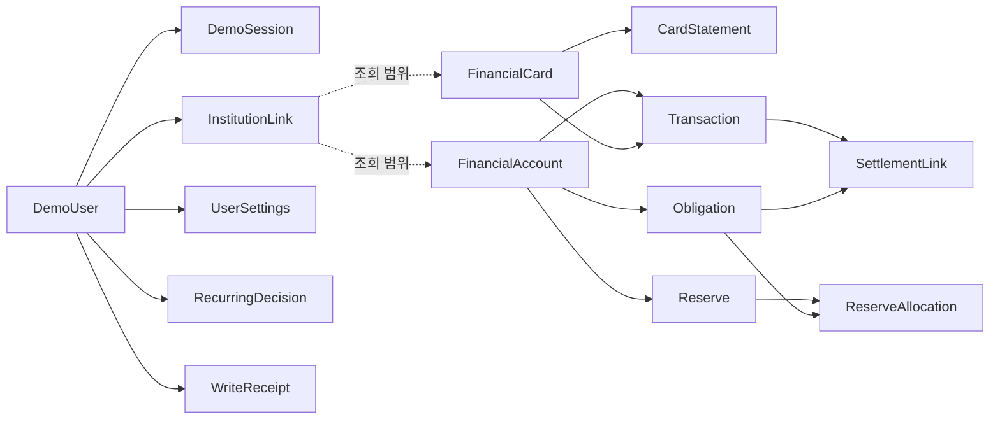

# PostgreSQL 최소 저장 구조 — 설계 기초안

최신 [업무표](references/work-brief.source.md)의 사용자별 저장·식별·재접속 유지·접근 차단을 위한 **후보 구조**다. 아래는 필수 저장 책임과 핵심 컬럼을 명시한 기초안이며 최종 SQL DDL·마이그레이션·테이블 수/컬럼 수 확정은 아니다. 기존 ‘14개 테이블·145개 컬럼’을 그대로 사용하지 않는다.

설계안의 물리 통합/분리는 A가 정하고 B가 조회·수정 시나리오로 확인한다. 앱 금액 계산 결과를 저장하는 테이블은 두지 않는다.

## 공통 타입·소유권

- 엔티티 ID는 내부 UUID, 원천 ID는 별도 text 참조다. 이름·전화번호로 PK를 만들지 않는다.
- demo_users는 id가 사용자 기본키다. 그 밖의 사용자 소유 행은 `user_id uuid NOT NULL`을 가진다. 별도 id가 있는 행은 `UNIQUE(user_id, id)`를 두고 같은 사용자 소유의 자식을 복합 FK로 연결하는 안이다. user_settings는 user_id 자체가 PK다.
- 금액은 `bigint` 원화 정수. 방향이 있는 거래는 방향+비음수 크기, 잔액은 음수 허용. 설정 금액은 비음수, 배정/정산액은 양수. 각 금액 절댓값 9조원 이하 검사를 적용한다. 합계도 별도 검사한다.
- 업무 날짜는 `date`, 확인된 시각은 `timestamptz`; 시각 미상은 null로 두고 날짜/정밀도를 보존한다. 날짜만 있는 자료에 자정 시각을 임의 삽입하지 않는다.
- 확정 변경에는 `data_version bigint`, 생성/변경 시각, 필요 시 취소/무효 시각을 둔다. 금융 원천은 일반 사용자 쓰기를 허용하지 않는다.
- JSONB는 금융 원천 자료·근거 목록·가변 설정에 한정한다. 소유권·금액·관계 제약이 필요한 항목을 모두 JSON 안에 숨기지 않는다.

## 저장 단위와 핵심 컬럼

각 행의 이름은 테이블 후보다. 기본키/소유키는 위 공통 기준을 따른다. null 허용 여부를 명시하지 않은 핵심 필드는 필수로 설계하고, 외부 자료에 없을 수 있는 필드는 null/확인 필요 상태를 함께 정의한다.

| 저장 단위              | 핵심 컬럼·타입                                                                                                                                                                                                                                                                                                                                                                      | 제약·설정 이유                                                                                                                    |
| ---------------------- | ----------------------------------------------------------------------------------------------------------------------------------------------------------------------------------------------------------------------------------------------------------------------------------------------------------------------------------------------------------------------------------- | --------------------------------------------------------------------------------------------------------------------------------- |
| demo_users             | id UUID, name text, synthetic_phone text, code_verifier text, data_version bigint, created_at timestamptz                                                                                                                                                                                                                                                                           | 사전 사용자 생성 때 ID 발급. name/phone은 합성 조회값, 별도 코드 확인. 제출 입력을 새 사용자로 자동 등록하지 않음                 |
| demo_sessions          | id UUID, user_id UUID, token_digest text, installation_id UUID, issued_at timestamptz, ended_at timestamptz nullable                                                                                                                                                                                                                                                                | user_id별 ended_at IS NULL 부분 UNIQUE. 기존 세션 우선·동시 발급 방지. installation_id만으로 인증 불가                            |
| institution_links      | id UUID, user_id UUID, institution_code text, institution_kind text, consented_at timestamptz, disconnected_at timestamptz nullable                                                                                                                                                                                                                                                 | 사용자+기관의 현재 연결 하나. 최종 동의 범위와 응답 노출 일치. 기관 종류는 bank/card 허용 목록                                    |
| financial_accounts     | id UUID, user_id UUID, institution_code text, source_ref text, product_type text, masked_number text, balance_krw bigint, as_of timestamptz, included boolean, nickname text nullable                                                                                                                                                                                               | 잔액/원천 참조는 읽기 전용, included/nickname만 사용자 변경 가능. 계좌별 보호 및 선택 합산에 필요                                 |
| financial_cards        | id UUID, user_id UUID, institution_code text, source_ref text, withdrawal_account_id UUID nullable, schedule_evidence jsonb                                                                                                                                                                                                                                                         | 출금 계좌 미상 허용+영향 계산 제한. 다른 사용자 계좌 참조 금지. 승인일/출금일 분리                                                |
| financial_transactions | id UUID, user_id UUID, source_ref text, account_id UUID nullable, card_id UUID nullable, amount_krw bigint, direction text, status text, purchase_date/withdrawal_date/refund_date date nullable, occurred_at timestamptz nullable, balance_reflected boolean, source_version text, original_transaction_id UUID nullable, payse_transaction_type text nullable, raw_fragment jsonb | 계좌/카드 중 적어도 하나. PAYSE 분류만 사용자 정정 가능. 취소/환불 원거래 참조는 같은 사용자만. 날짜 전부 미상이면 집계 누락 표시 |
| card_statements        | id UUID, user_id UUID, card_id UUID, source_ref text, due_date date nullable, amount_krw bigint, included_transaction_refs jsonb                                                                                                                                                                                                                                                    | 청구 총액과 포함 승인을 함께 차감하지 않기 위한 연결. 포함 참조는 같은 사용자/카드인지 서비스 검증                                |
| obligations            | id UUID, user_id UUID, withdrawal_account_id UUID, amount_krw bigint, due_date date, status text, statement_id UUID nullable, recurrence_key text nullable                                                                                                                                                                                                                          | 승인/취소 상태·필요 회차 고유성. 지급 완료 boolean 수동 수정 대신 유효 정산 연결로 잔여 산출                                      |
| settlement_links       | id UUID, user_id UUID, obligation_id UUID, transaction_id UUID, allocated_krw bigint, method text, evidence jsonb, invalidated_at timestamptz nullable                                                                                                                                                                                                                              | 자동/수동 구분·원천 출금/의무 한도 내 배정. 정정은 무효화/재연결로 추적, 원천 거래 수정 없음                                      |
| reserves               | id UUID, user_id UUID, account_id UUID, label text, amount_krw bigint, cancelled_at timestamptz nullable                                                                                                                                                                                                                                                                            | amount는 정산 해제를 반영한 현재 보호 설정 R. 신규/증액 시 계좌별 및 전체 상한, 잔액 하락만으로 자동 감액 없음                    |
| reserve_allocations    | id UUID, user_id UUID, reserve_id UUID, obligation_id UUID, amount_krw bigint, released_krw bigint, release_evidence jsonb                                                                                                                                                                                                                                                          | O와 지급 후 보호 해제 근거. released는 0~amount. 한도는 미해제분 amount−released 합계로 검사. 정정 시 근거 있는 해제만 복원       |
| user_settings          | user_id UUID PK, salary_day smallint, salary_amount_krw bigint, salary_account_id UUID nullable, salary_evidence jsonb, card_plan_overrides jsonb                                                                                                                                                                                                                                   | 급여일1~31·금액 비음수. 미입력은 null 허용+미완료 상태. 사용자 예정 결제일은 원천 실제 일정을 덮지 않음                           |
| recurring_decisions    | id UUID, user_id UUID, candidate_key text, rule_version text, evidence_refs jsonb, normalized_name text, decision text, obligation_id UUID nullable                                                                                                                                                                                                                                 | 근거 집합+규칙별 승인/제외 고유. 같은 제외 후보 재등장 방지. 금액 수치의 권위는 로컬 규칙/사용자 확정                             |
| write_receipts         | id UUID, user_id UUID, operation_key text, request_digest text, action text, changed_refs jsonb, before_after jsonb, result_version bigint, created_at timestamptz                                                                                                                                                                                                                  | 사용자+작업키 UNIQUE. 설정/연결 변경과 원자 저장, 재시도·최소 변경 기록 겸용. 민감 인증 입력·가상 소비 제외                       |

계좌/카드의 기관 코드는 준비된 규격 목록을 참조한다. 형식 동의 전에 시드가 존재하므로 동의 완료 행을 원천 레코드 생성의 필수 조건으로 두지 않는다. 반환 시에는 별도 institution_links의 해당 사용자 동의/연결 범위를 검사한다.

MVP 합성 금융 자료는 서버의 버전 있는 읽기 전용 JSON과 자료 설명(manifest)으로 보존할 수 있다. CODEF 전체 응답 복제·저장은 요구하지 않는다. raw_fragment를 사용하면 해당 합성/외부 원천의 거래 조각이며 PAYSE API 전체 응답과 구분한다. source_ref/source_version으로 원천과 정규화 객체를 추적한다. 준비된 데모 사건은 새 버전/명시 사건으로 적용하며 일반 사용자에게 원천 금액 편집을 허용하지 않는다.

이 표의 14개 저장 단위가 모든 구현에서 최솟값이라는 뜻은 아니다. 원천 JSON 파일을 서버에서 읽고 DB에는 식별/설정만 두는 대안도 가능하지만 동일 사용자·버전·참조 안정성을 유지해야 한다. 별도 감사/멱등 테이블을 분리할지는 보존기간과 구현 필요로 정하며, 기존 14/145 설계를 채택했다는 근거로 이 숫자를 사용하지 않는다.

## PAYSE 공통 전달 형식과 저장 위치

개정일 2026-10-18. 아래는 기존 저장 후보의 대응표이며 SQL DDL·새 테이블 추가 승인이 아니다. 전달 필드의 의미는 [데이터 계약](data-contracts.md)이 기준이다.

| 전달 정보                                                                        | 기존 저장 위치                                                                                | 저장/변경 규칙                                                                                           |
| -------------------------------------------------------------------------------- | --------------------------------------------------------------------------------------------- | -------------------------------------------------------------------------------------------------------- |
| accountId / institutionCode / productType / maskedNumber / balanceKRW / asOf     | financial_accounts.id / institution_code / product_type / masked_number / balance_krw / as_of | 원천 읽기 전용. 포함 여부 included와 별칭 nickname만 사용자 설정                                         |
| cardId / withdrawalAccountId / scheduleEvidence                                  | financial_cards.id / withdrawal_account_id / schedule_evidence                                | 실제 출금 계좌·일정과 사용자 계획을 분리                                                                 |
| transactionId / amountKRW / direction / status / 날짜·시각 / 원거래 / PAYSE 분류 | financial_transactions의 대응 컬럼                                                            | 원천 금액·날짜·상태 불변. payse_transaction_type만 분류 정정                                             |
| statementId / cardId / dueDate / amountKRW / includedTransactionRefs             | card_statements.id / card_id / due_date / amount_krw / included_transaction_refs              | 명세 참조와 완전성을 구분. 별도 청구 상세 테이블은 조회·FK·갱신 제약이 필요할 때 설계                    |
| 지급 의무·실제 출금 연결                                                         | obligations / settlement_links                                                                | 부분 정산·정정 근거와 소유권을 기존 관계로 검증                                                          |
| 자료 버전·범위·합성 출처·누락 정보                                               | 기존 source_version / 사용자 data_version / 더미 manifest 또는 조회 응답 구성                 | 공통 메타데이터를 모든 행에 복제하지 않음. 별도 저장이 필요하면 수명·조회·제약 근거를 먼저 명시          |
| 제품 표시명·거래 설명·카드 상세 명세                                             | 기존 읽기 전용 원천 JSON 또는 필요한 정규화 컬럼                                              | API 필드 추가만으로 컬럼 신설하지 않음. 검색·관계 제약·독립 갱신 필요 시 A가 물리 설계하고 B가 조회 확인 |
| U·소비 집계·미래 잔액·가상 구매 목록                                             | 영속 저장하지 않음                                                                            | Flutter 계산/흐름 메모리. 사용자 확정 설정만 서버 저장                                                   |

조회 실패를 표현하기 위해 모든 금액 컬럼의 NOT NULL을 제거하지 않는다. 원천 누락/실패 상태와 계산 가능한 정상 행을 구분한다. API의 null 정책과 DB 제약을 동일한 것으로 간주하지 않는다. 신규 ID·테이블·컬럼을 채택할 경우 기존 원거래/청구/정산 참조로 해결할 수 없는 요구와 마이그레이션을 명시한다.

## 관계와 검증 경계

위 그림은 관계 개요이며 완성 ERD의 cardinality·FK·삭제 규칙을 대신하지 않는다. 최신 업무표의 ERD 산출 완료로 체크하지 않는다.

- 단일 행 범위·상태는 CHECK/NOT NULL, 중복은 UNIQUE, 소유권 관계는 복합 FK로 제한한다.
- 복수 행의 보호 합계·정산 배정 합계는 단순 CHECK로 보장했다고 쓰지 않는다. 사용자/대상 행 잠금 또는 동등한 직렬화·버전 조건을 적용한 한 트랜잭션에서 검증한다. 서버가 U를 계산하지 않아도 이 저장 제약은 필요하다. [PostgreSQL 제약](https://www.postgresql.org/docs/current/ddl-constraints.html)
- 원천 참조의 유일 키는 기관+API+원천 식별 근거로 정의한다. 같은 금액/날짜 해시를 경제적 거래 고유키로 사용하지 않는다. 원천이 고유 ID를 주지 않는 경우 더미 매핑에서 명시 ID를 제공하고 실연동 보장으로 확대하지 않는다.
- 취소/정정 시 연결·배정·변경 기록·dataVersion을 함께 커밋한다. 하나만 성공하는 저장은 허용하지 않는다. [PostgreSQL 트랜잭션](https://www.postgresql.org/docs/current/tutorial-transactions.html)
- 세션 종료 시 금융 설정을 CASCADE 삭제하지 않는다. 사용자 레코드 물리 삭제는 일반 데모 로그아웃 API가 아니다.
- 정산액/배정 해제액/소비 집계 결과를 중복 권위로 저장하지 않는다. 필요 추적값은 원천 링크·변경 근거와 일치시킨다.
- 가상 구매·미래 비교 결과·PIN·가입 제출 원문·실제 본인확인 자료 테이블은 만들지 않는다. 실제 인증자료 수집 기능도 없다.

## 상세 명세 전 보완

정확한 컬럼명·null 정책·허용 상태값·인덱스·FK 삭제 동작·원천 버전 교체·원거래/환불 참조·급여 입금 근거·변경 기록 보존은 데이터/API 상세에서 확정한다. 이 목록은 제품 동작을 다시 고르는 질문이 아니다. 현재 문서는 누락 방지용 설계 근거이고 DB에 적용한 스키마가 아니다.

## 단일 이름 저장 목표 — 2026-10-21

`demo_users.name`은 합성 인증 이름과 허용 화면 호칭을 겸하는 필수 컬럼이다. 조회 조합은 `(name, synthetic_phone)`이며 공백 없는 인증 식별값만 저장한다. 사용자 UUID·전화번호·금융 FK는 유지한다. 이 표는 변경 목표다. 현재 `001_initial.sql`과 생성 시드는 구 이름 두 필드를 유지하므로 아직 새 컬럼이 설치됐다고 보고하지 않는다. 세 이름·형식·미실행 이행 범위는 [인증 설계 §2](../apps/api/docs/v0.6/auth-design.md)를 따른다. 금융 상품명·메모·별칭의 공백 제거, 기존 DB 재생성·데이터 삭제는 포함하지 않는다.

연결 전/부분 연결 표현은 별도 원천 테이블 증설 근거가 아니다. 기관 연결 상태와 사용자 설정을 기준으로 조회할 때 투영하며, accessRestrictions와 숨김 여부를 실제 원천 null·거래 삭제·지급 상태 변경으로 저장하지 않는다. 세 계정 초기 상태와 재접속 유지의 상세는 [응답 모델](../apps/api/docs/v0.6/response-models.md)을 따른다.
